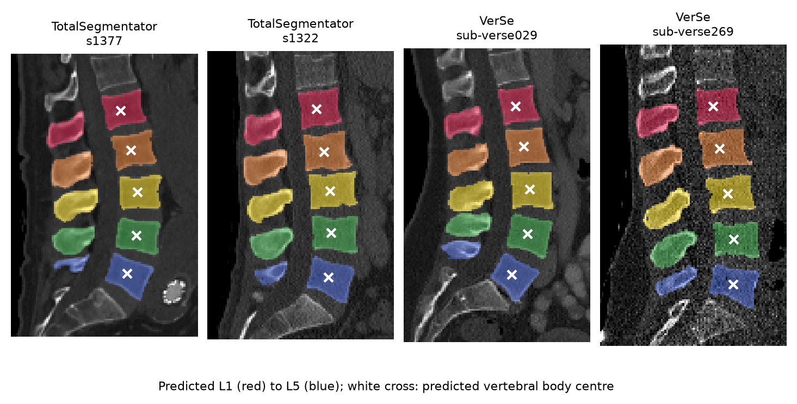
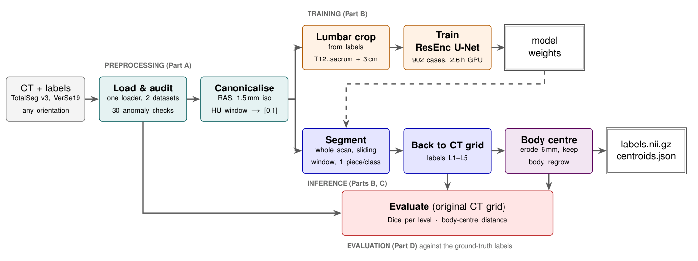
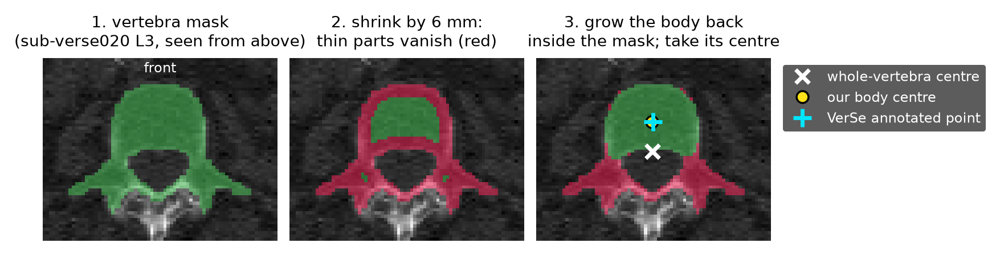
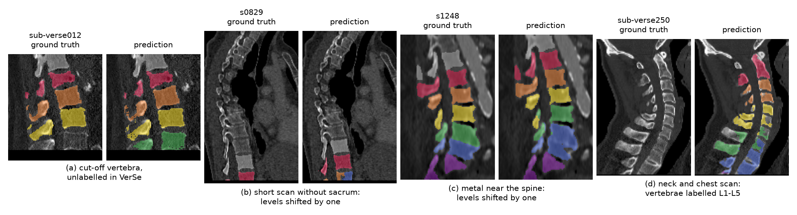
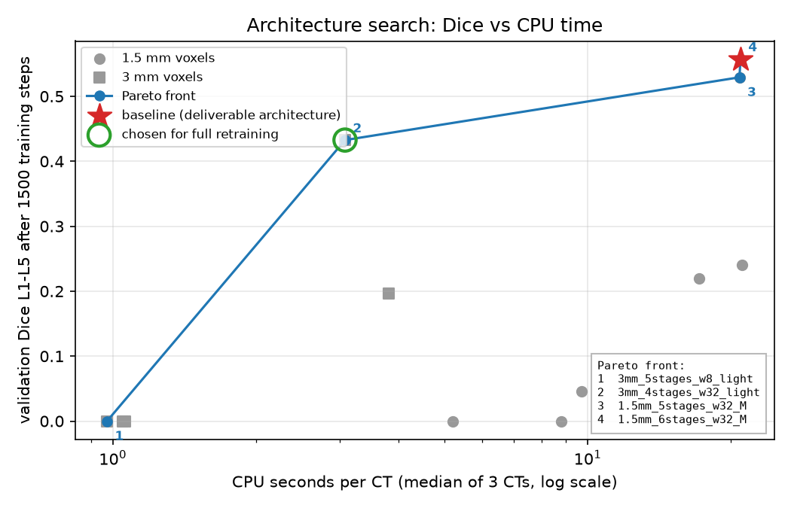
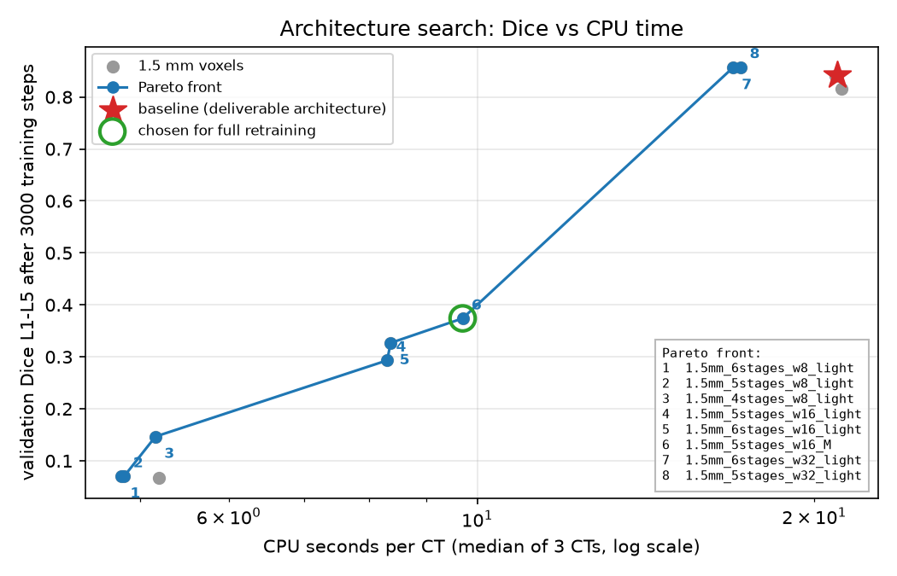

# Lumbar spine L1–L5 segmentation from CT

This project finds the five lumbar vertebrae (L1–L5) in a CT scan and the centre of each
vertebral body. For every CT it writes:

- a label map: every voxel marked as background, L1, L2, L3, L4 or L5;
- a JSON file with the centre of each vertebral body in world coordinates (RAS, mm).

A 3D U-Net, trained from scratch on TotalSegmentator, does the segmentation. A shape rule then
cuts the vertebral body out of each vertebra.



*Model output on four test scans (side view, head up, front of the body to the right): predicted
L1 (red) to L5 (blue), and the predicted centre of each vertebral body (white cross).*

**Results** (Dice per vertebra, 1 = perfect overlap with the ground truth):

| Test set | Median Dice | Mean Dice |
|---|---|---|
| [TotalSegmentator](https://github.com/wasserth/TotalSegmentator) test split (in-domain, 78 scans) | **0.97** | 0.89 |
| [VerSe 2019](https://github.com/anjany/verse) (out-of-domain, never seen in training, 67 scans) | **0.94** | 0.91 |

Body centres lie a median of **1.0 mm** from the centre points marked by VerSe experts. Most of
the remaining errors come from a few scans where whole vertebrae get the wrong level name.

The full write-up is the two-page report [`report/lumbar_spine_report_Rezaei.pdf`](report/lumbar_spine_report_Rezaei.pdf).



*Preprocessing is shared by training (top) and inference (bottom). The evaluation compares
the outputs with the ground truth on the original CT grid.*

## Run the trained model

```bash
cd lumbar
./run_inference.sh <folder with CT files> <output folder>
```

- Input: CT files (`.nii.gz` or `.nii`) in any orientation.
- Output per CT: `<case>_lumbar_labels.nii.gz` (same grid as the CT, 1–5 = L1–L5) and
  `<case>_centroids.json`.
- Needs Python 3.10–3.12 and internet on the first run, which installs the pinned packages into
  `lumbar/.venv_inference`. CPU only: no GPU, no Docker. Tested on Windows 11 (Git Bash); plain bash,
  so Linux and macOS work the same. About 1–3 min per CT on a laptop.
- The weights (`lumbar/weights/*.pt`, 391 MB) are stored with Git LFS: run `git lfs pull` after cloning.
- If Python is not found, set `PYTHON=/path/to/python`. On Windows, keep the folder path short
  (well under 100 characters): PyTorch's DLLs fail to load past the 260-character path limit.

## 1. Preprocessing and data problems

**Data.** TotalSegmentator v3 (1939 CTs) with its official split: 1830 for training, 109 for
testing. VerSe 2019 (80 CTs) is used only for testing, so it stays an unseen dataset. One loader
reads both.

**Three steps, the same in training and inference:**

1. **Orientation:** image and labels are turned into RAS orientation through their affine matrix.
2. **Voxel size:** 1.5 mm in every direction. This is the native size of all TotalSegmentator
   scans, so the training data are not degraded.
3. **Intensity:** Hounsfield units are clipped to −1000…1500 and scaled to 0…1. A fixed window keeps
   bone at the same value in every scan.

**Data problems.** An automatic check tests every file for 30 kinds of problems and decides how
each is handled. The most common: VerSe images not stored axially (48 of 80), overlapping
TotalSegmentator masks at S1/L5 (817 scans), vertebrae cut off by the scan edge (431), metal near
the spine (124 + 4), and three VerSe patients with a sixth lumbar vertebra (L6). The full table is
in the report and in `outputs/qc/anomaly_report.md`. Preprocessing moves structure centres by a
median of 0.07 mm (TotalSegmentator) and 0.46 mm (VerSe).

## 2. Model and training

- **Network:** the residual-encoder U-Net ("ResEnc M", 102 M parameters) from *nnU-Net Revisited*
  (Isensee et al., MICCAI 2024), trained from scratch. Only the network is taken, not the nnU-Net
  framework: its default mirroring along every axis would swap L1 and L5.
- **Classes:** L1–L5, plus T12 and the sacrum as landmarks that help count the levels.
- **Training data:** crops from T12 to the sacrum + 3 cm; 902 training and 100 validation scans.
  Each patch is 128 × 128 × 224 voxels (19 × 19 × 34 cm), big enough to hold the whole lumbar spine.
- **Setup:** cross-entropy + Dice loss, nnU-Net default optimiser settings unchanged, no data
  augmentation, 11 000 steps, batch 3, 2.6 h on one RTX 3090. Best validation Dice: 0.905.
- **Inference:** the network slides over the whole scan; per level only the largest connected piece
  is kept, and the result is mapped back to the original CT grid.

## 3. Vertebral body centre

The body is the only part of a vertebra thicker than about 12 mm. So the method:

1. shrinks the vertebra mask by 6 mm, which removes all thin parts;
2. keeps the largest remaining piece that does not lie behind the vertebra's centre;
3. grows it back by 6 mm, but only inside the original mask;
4. takes its centre of mass in world coordinates.



*L3 of VerSe scan sub-verse020, front at the top. Green: kept; red: removed.*

**Check against VerSe.** VerSe marks one point per vertebra, and these points sit at the body
centre. On the ground-truth masks the extracted centre lies a median of **0.9 mm** from them,
against 12.5 mm for the centre of the whole vertebra. On the predicted masks: 1.0 mm.

## 4. Evaluation on two test sets

Dice is computed on the original CT grid, only for levels present in the ground truth. VerSe
L6 and T13 keep their own labels, so they are never counted as L5, T12 or background.

| Test set | L1 | L2 | L3 | L4 | L5 | All | Limit |
|---|---|---|---|---|---|---|---|
| TotalSegmentator test (in-domain, 78 scans) | .88 / .97 | .90 / .97 | .92 / .97 | .91 / .97 | .87 / .96 | **.89 / .97** | 1.00 |
| VerSe19 (out-of-domain, 67 scans) | .90 / .94 | .91 / .94 | .92 / .94 | .91 / .94 | .89 / .93 | **.91 / .94** | .96 |

*Mean / median Dice. Limit: the best score possible at 1.5 mm (ground truth resampled to 1.5 mm and back).*

**Why the numbers differ.** VerSe voxels do not lie on the 1.5 mm grid, which alone caps its
Dice at 0.96. Measured against these caps, a typical vertebra is segmented about equally well on
both datasets. The means are lower than the medians because a few scans fail as a whole:

- **Wrong level count:** in 3 scans the vertebrae are found but named one level off: short scans
  without the sacrum or ribs as landmarks, or next to metal.
- **Cut-off vertebrae** are hard to segment and name. TotalSegmentator labels them, VerSe hardly
  does; without them the TotalSegmentator mean rises from 0.89 to 0.92.
- **False lumbar vertebrae** in scans that show only the chest or neck: 23 whole vertebrae are
  labelled L1–L5. The model was trained on lumbar crops only and never saw such anatomy.
- **Patients with L6** are handled correctly (Dice 0.87–0.95 per level).



*Ground truth next to prediction: (a) cut-off vertebra unlabelled in VerSe, (b, c) levels shifted
by one, (d) neck and chest scan labelled L1–L5. L1 red, L2 orange, L3 yellow, L4 green, L5 blue,
T12 grey, sacrum purple.*

## 5. Next steps

- Train with some patches from whole scans, or add a "lumbar spine present?" check, against the
  false vertebrae.
- Check the level names with a rule (vertebrae ordered head to feet, T12 and sacrum as anchors).
- Train longer: the best checkpoint was the last one.

## 6. Extension: a faster model for CPU-only inference (architecture search)

*Branch `nas-efficiency` only. The deliverable model above is unchanged.*

**Question.** Can a smaller or coarser model run much faster on a CPU and keep nearly the same
Dice? Instead of guessing, a small multi-objective architecture search answers it.

**What was searched** (36 architectures, `lumbar/src/lumbar/architecture_search_space.py`):
voxel size 1.5 or 3 mm (the "sensor" setting: how finely the CT is resampled), 4, 5 or 6
resolution stages (depth), 8, 16 or 32 channels in the first stage (width; doubles per stage, at
most 320), and "light" (1-1-2-2-2-2) or "M" (1-3-4-6-6-6) residual blocks. Changing resolution,
depth and width together follows EfficientNet [1]. The patch stays 19.2 x 19.2 x 32 cm; at 3 mm it
is 64 x 64 x 96 voxels (28.8 cm long, rounded to a multiple of 32). 2 mm was planned too but left
out to finish overnight. The deliverable's architecture (1.5 mm, 6 stages, width 32, M) is one
point of the space.

**How.**
1. *CPU cost, measured* (script 11): the full CPU inference of `predict_ct` (resampling, sliding
   window, clean-up) with untrained weights, on 3 fixed CTs, 8 threads, for all 36 architectures.
   The cost is measured on the real machine, not estimated from FLOPs, as in MnasNet [2]. Width
   and voxel size set the cost; depth and blocks hardly matter (`outputs/nas/cpu_time_per_architecture.csv`).
2. *Search* (script 12): Optuna's [3] NSGA-II sampler [4], the genetic algorithm also used by
   NSGA-Net [5], with two objectives: Dice L1–L5 on the **original CT grid** of 20 fixed validation
   CTs (the only grid where 1.5 and 3 mm models are comparable; maximise), and CPU seconds per CT
   from step 1 (minimise). Every candidate trains from scratch for the same short budget, 1500
   steps (same batch, optimiser and schedule as script 04). The baseline was the first trial.
   12 different architectures in 2 h (15 trials, 3 were repeats); population 6.
3. *Pick and retrain* (scripts 13, 04): the fastest point of the Pareto front within 0.02 Dice of
   the baseline, if none: the best Dice among Pareto points at least 2x faster than the baseline.
   Retrained with the full 11 000-step schedule (`04 --architecture`, 15 min on the GPU), then
   evaluated with script 06 and compared with script 08.



**Result.** The chosen model: 3 mm voxels, 4 stages, width 32, light blocks.

| | Deliverable (1.5 mm, 6 stages, w32, M) | NAS model (3 mm, 4 stages, w32, light) |
|---|---|---|
| Parameters | 102.4 M | 9.5 M |
| CPU s per scan, 6 scans, 18 cores, median | 32.0 | **3.5** |
| Peak RAM during CPU inference (8 threads) | 10.3 GB | 1.9 GB |
| Dice TotalSegmentator test, mean / median | 0.894 / 0.965 | 0.788 / 0.882 |
| Dice VerSe19, mean / median | 0.906 / 0.939 | 0.828 / 0.893 |
| Best possible Dice at this voxel size (resampling ceiling), TotalSeg / VerSe | 1.000 / 0.956 | 0.891 / 0.913 |
| Scans counted one level off, TotalSeg / VerSe | 2 / 1 | 3 / 2 |

In plain words: **9x faster and 11x smaller, but about 0.1 Dice lower.** Most of the loss comes
from the 3 mm voxels, not from the small network: even a perfect 3 mm prediction cannot score
more than 0.89–0.91, and the median Dice (0.88 / 0.89) is close to that limit. Level counting stays
about as good. Full tables: `outputs/evaluation_comparison_deliverable_1.5mm_vs_nas_fast.md`.

### Second search: 1.5 mm voxels only

**Question.** The 3 mm model is fast but loses about 0.1 Dice through its voxel size. Is there a
model at the deliverable's 1.5 mm voxels that is faster and nearly as good on the test sets?

**How.** The same search, but only over the 18 architectures at 1.5 mm, with a longer short budget
of 3000 steps (1500 steps had left the narrow models at Dice 0). 12 different architectures in
5 h; population 6; same 20 validation CTs and the same CPU-time table. The pick rule was fixed
before the search started (`13 --min-speedup 1.5 --dice-margin 0.03`): among the Pareto points at
least 1.5x faster than the baseline, the fastest one within 0.03 Dice of it; if none, the one with
the best Dice. No point was both, so the rule took the best Dice among the fast ones:
**5 stages, width 16, M blocks**. The best Dice of the whole search, **5 stages, width 32, light
blocks** (only 1.2x faster), was also fully retrained, on request, to see what a wide but shallower
model gives. Both models were retrained with the full schedule on the same training cases as the
deliverable and evaluated like it.



| Search Dice after 3000 steps | CPU s per CT (search table) | Architecture (1.5 mm) |
|---|---|---|
| 0.842 | 21.0 | 6 stages, w32, M (baseline) |
| 0.858 | 17.2 | 5 stages, w32, light (retrained) |
| 0.856 | 16.9 | 6 stages, w32, light |
| 0.374 | 9.7 | 5 stages, w16, M (retrained, chosen by the rule) |
| 0.327 / 0.293 | 8.4 / 8.3 | 6 / 5 stages, w16, light |
| 0.07–0.15 | 4.8–5.2 | width 8 (4 architectures) |

Full table: `outputs/nas_1.5mm/pareto_front.md`.

### All models side by side

Test sets as in section 4. CPU time measured for all four models in one session on the same
6 scans (`outputs/cpu_inference_seconds_per_scan.csv`); parameters and peak RAM from script 11.

| | Deliverable | NAS 3 mm | NAS 1.5 mm, w16 M | NAS 1.5 mm, w32 light |
|---|---|---|---|---|
| Architecture | 1.5 mm, 6 stages, w32, M | 3 mm, 4 stages, w32, light | 1.5 mm, 5 stages, w16, M | 1.5 mm, 5 stages, w32, light |
| Parameters | 102.4 M | 9.5 M | 28.0 M | 24.3 M |
| CPU s per scan, median of 6 (speed-up) | 32.0 | **3.5 (9x)** | **15.0 (2.1x)** | 25.5 (1.25x) |
| Peak RAM, CPU inference (8 threads) | 10.3 GB | 1.9 GB | 5.8 GB | 10.0 GB |
| Validation Dice (100 cases, model grid) | 0.905 | 0.90 | 0.913 | 0.915 |
| Dice TotalSeg test, mean / median | 0.894 / 0.965 | 0.788 / 0.882 | **0.900 / 0.962** | 0.896 / 0.968 |
| Dice TotalSeg test, not cut off, mean | 0.921 | 0.833 | 0.923 | 0.937 |
| Dice VerSe19, mean / median | 0.906 / 0.939 | 0.828 / 0.893 | **0.895 / 0.937** | 0.891 / 0.939 |
| Scans counted one level off, TotalSeg / VerSe | 2 / 1 | 3 / 2 | 1 / 1 | 1 / 1 |
| Body centre to ground truth, 90th pct, TotalSeg / VerSe (mm) | 15.7 / 3.9 | 26.9 / 8.3 | 6.3 / 4.0 | 13.9 / 4.0 |
| Vertebra-sized false-positive levels (>= 20 ml), TotalSeg / VerSe | 11 / 26 | 8 / 15 | 26 / 21 | 8 / 12 |

In plain words: **the 1.5 mm, width 16, M model answers the question.** It is about 2x faster on
the CPU, needs about half the memory and is 3.7x smaller, and its test Dice is the same as the
deliverable's on TotalSegmentator (0.900 vs 0.894) and 0.011 lower on VerSe (0.895 vs 0.906; the
medians differ by 0.002). It counts levels at least as well. Its one weak point: more large
false-positive pieces on TotalSegmentator (26 vs 11 levels of at least 20 ml predicted where the
ground truth has none). The width 32, light model has the best Dice on complete vertebrae and
the fewest large false positives, but it is only 1.25x faster. The 3 mm model remains the choice
only when speed matters much more than accuracy. Full tables:
`outputs/evaluation_comparison_deliverable_vs_nas_3mm_w32_light_vs_nas_1.5mm_w16_M_vs_nas_1.5mm_w32_light.md`.

**Limitations (honest).**
- The short training is a weak stand-in for the full one. After 1500 steps most narrow models
  (width 8 or 16) had not started to segment yet (Dice 0), and the chosen model rose from 0.43 in
  the search to 0.90 validation Dice after the full training. The search can rank the models only
  roughly. Even 3000 steps (second search) underrate narrow models badly: width 16, M went from
  0.374 in the search to 0.913 after the full training, as good as the wide models. A search that
  trains each candidate longer (or the narrow ones with a higher learning rate) would probably move
  the front towards smaller models.
- The second retrained model (width 32, light) was not picked by the fixed rule but added on
  request after the search; it is reported as an extra comparison, not as a search result.
- One training run per model: Dice differences of about 0.01 between the 1.5 mm models are within
  what another random seed could change.
- With the planned rule nothing faster than the baseline was within 0.02 Dice, so the fallback
  rule (best Dice among models at least 2x faster) was added during the overnight run.
- Small search: 12 of 36 architectures, about 2.5 generations of 6; no 2 mm. A 2 mm model is probably the
  better middle point (the first 2 mm model: 13.5 s per scan, Dice 0.881 / 0.851).
- One CPU (i9-10980XE), one run per CT in step 1. Peak RAM includes the three loaded CTs.
- The 3 mm training crops are coarser: volume ratio preprocessed / original 0.87–1.30 (script 03),
  against 0.95–1.00 at 1.5 mm.
- The NAS weights (`outputs/nas/weights/`, 3 files, 237 MB) are not in git.

**Files.** `outputs/nas/`: CPU-time table, search table (`search_trials.csv`), Optuna study
(`architecture_search.db`), Pareto plot and table (`pareto_front.md`), chosen architecture, console
logs. Evaluation: `outputs/evaluation_nas_fast/`, `outputs/predictions_nas_fast/`; training log:
`outputs/training/nas_fast/`. Second search: `outputs/nas_1.5mm/` (same files, plus
`driver_log.txt`); evaluations `outputs/evaluation_nas_1.5mm/` (w16 M) and
`outputs/evaluation_nas_1.5mm_w32_light/`, with the matching `predictions_*` and `training/*` folders.

**Sources.**
[1] M. Tan, Q. V. Le. EfficientNet: Rethinking Model Scaling for Convolutional Neural Networks. ICML 2019.
[2] M. Tan, B. Chen, R. Pang, V. Vasudevan, M. Sandler, A. Howard, Q. V. Le. MnasNet: Platform-Aware Neural Architecture Search for Mobile. CVPR 2019.
[3] T. Akiba, S. Sano, T. Yanase, T. Ohta, M. Koyama. Optuna: A Next-generation Hyperparameter Optimization Framework. KDD 2019.
[4] K. Deb, A. Pratap, S. Agarwal, T. Meyarivan. A Fast and Elitist Multiobjective Genetic Algorithm: NSGA-II. IEEE Transactions on Evolutionary Computation 6(2), 2002.
[5] Z. Lu, I. Whalen, V. Boddeti, Y. Dhebar, K. Deb, E. Goodman, W. Banzhaf. NSGA-Net: Neural Architecture Search using Multi-Objective Genetic Algorithm. GECCO 2019.

## Reproduce the whole pipeline

**Setup** (any OS, Python 3.10+):

```bash
python -m venv .venv
source .venv/bin/activate          # Windows: .venv\Scripts\activate
pip install -e lumbar
```

**Data** (not in this repository). Put these zips into `data/archives/`, or set
`LUMBAR_DATA=/path/to/data` to a folder that contains `archives/`:

| File | Source |
|---|---|
| `Totalsegmentator_dataset_v300.zip` (35 GB, do not unzip) | TotalSegmentator v3.0.0, Zenodo record 22688904 |
| `dataset-verse19validation.zip`, `dataset-verse19test.zip` | VerSe 2019, https://github.com/anjany/verse |

**Steps** (run from inside `lumbar/`; each script's `--help` says what it does and writes):

```bash
python scripts/00_extract_verse_archives.py                       # unzip VerSe
python scripts/01_find_header_and_label_anomalies.py --workers 8  # data problems -> outputs/qc/anomaly_report.md
python scripts/02_preprocess_cases_for_training.py --workers 8    # training crops at 1.5 mm
python scripts/03_verify_preprocessed_cases.py                    # checks + side views -> outputs/qc/
python scripts/04_train_lumbar_segmentation_model.py --max-hours 6 \
    --same-cases-as ../outputs/training/resenc_m_1.5mm/training_cases.csv    # needs an NVIDIA GPU
python scripts/05_predict_lumbar_vertebrae.py <in> <out>          # what run_inference.sh calls
python scripts/06_evaluate_on_test_sets.py                        # Dice, centres -> outputs/evaluation_1.5mm/
python scripts/07_make_report_figures.py --tag 1.5mm              # failure-case figure
python scripts/09_draw_body_centre_steps.py                       # body-centre figure
python scripts/10_draw_example_segmentations.py                   # example figure at the top of this README
# architecture search (section 6; needs `pip install optuna`)
python scripts/02_preprocess_cases_for_training.py --spacing 3 --workers 8   # 3 mm crops
python scripts/11_measure_cpu_time_of_architectures.py            # CPU time of all architectures
python scripts/12_search_architectures_with_nsga2.py --max-hours 2 # NSGA-II search -> outputs/nas/
python scripts/13_plot_pareto_front.py                            # Pareto plot, chosen_architecture.json
python scripts/04_train_lumbar_segmentation_model.py --architecture ../outputs/nas/chosen_architecture.json \
    --same-cases-as ../outputs/training/resenc_m_1.5mm/training_cases.csv --run nas_fast
python scripts/06_evaluate_on_test_sets.py --weights ../outputs/nas/weights/3mm_4stages_w32_light.pt --tag nas_fast
# second search, 1.5 mm only
python scripts/12_search_architectures_with_nsga2.py --spacings 1.5 --steps 3000 --trials 12 --population 6 \
    --validation-cases 20 --max-hours 6 --study lumbar_cpu_nas_1.5mm --out-dir ../outputs/nas_1.5mm
python scripts/13_plot_pareto_front.py --out-dir ../outputs/nas_1.5mm --min-speedup 1.5 --dice-margin 0.03
python scripts/04_train_lumbar_segmentation_model.py --architecture ../outputs/nas_1.5mm/chosen_architecture.json \
    --same-cases-as ../outputs/training/resenc_m_1.5mm/training_cases.csv --run nas_1.5mm
python scripts/06_evaluate_on_test_sets.py --weights ../outputs/nas/weights/1.5mm_5stages_w16_M.pt --tag nas_1.5mm
python scripts/04_train_lumbar_segmentation_model.py --architecture ../outputs/nas_1.5mm/second_choice_architecture.json \
    --same-cases-as ../outputs/training/resenc_m_1.5mm/training_cases.csv --run nas_1.5mm_w32_light
python scripts/06_evaluate_on_test_sets.py --weights ../outputs/nas/weights/1.5mm_5stages_w32_light.pt --tag nas_1.5mm_w32_light
python scripts/08_compare_two_evaluations.py --tags 1.5mm nas_fast nas_1.5mm nas_1.5mm_w32_light \
    --names deliverable nas_3mm_w32_light nas_1.5mm_w16_M nas_1.5mm_w32_light
```

Add `--limit 5` to steps 01, 02 and 06 for a quick test. For training, install the CUDA build of
PyTorch first (`pip install torch==2.6.0 torchvision==0.21.0 --index-url https://download.pytorch.org/whl/cu124`)
and check `torch.cuda.is_available()` afterwards: installing other packages can replace it with
the CPU build.

## Datasets

- **TotalSegmentator** v3.0.0 — https://github.com/wasserth/TotalSegmentator (data: Zenodo record 22688904).
  Wasserthal J. et al., *TotalSegmentator: Robust segmentation of 104 anatomic structures in CT images*,
  Radiology: Artificial Intelligence, 2023.
- **VerSe 2019** — https://github.com/anjany/verse.
  Sekuboyina A. et al., *VerSe: A Vertebrae labelling and segmentation benchmark for multi-detector CT images*,
  Medical Image Analysis, 2021.

**Where things are:** code in `lumbar/` (library in `lumbar/src/lumbar/`, scripts in
`lumbar/scripts/`), results in `outputs/`, report and figures in `report/`. The first model,
trained at 2 mm, is kept on the branch `model-2mm`.
